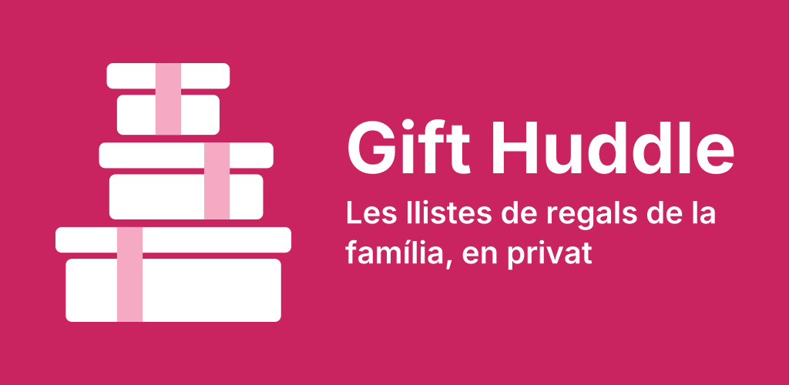
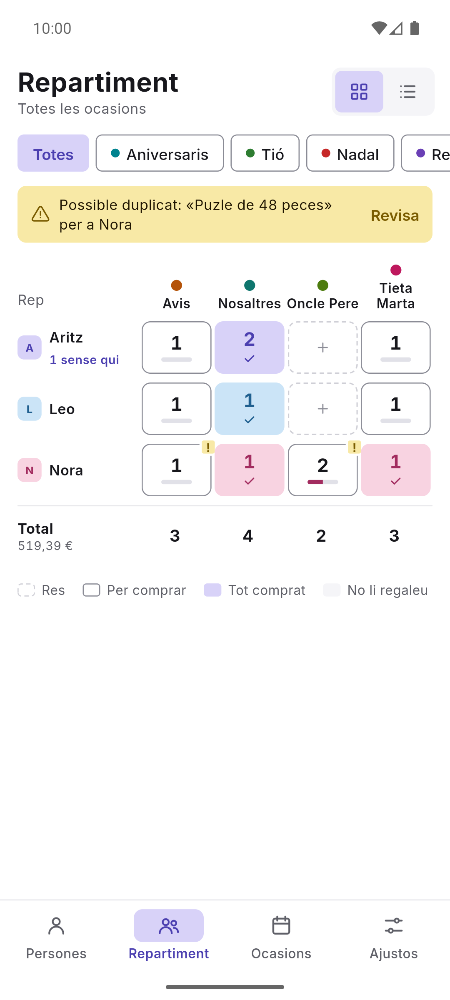
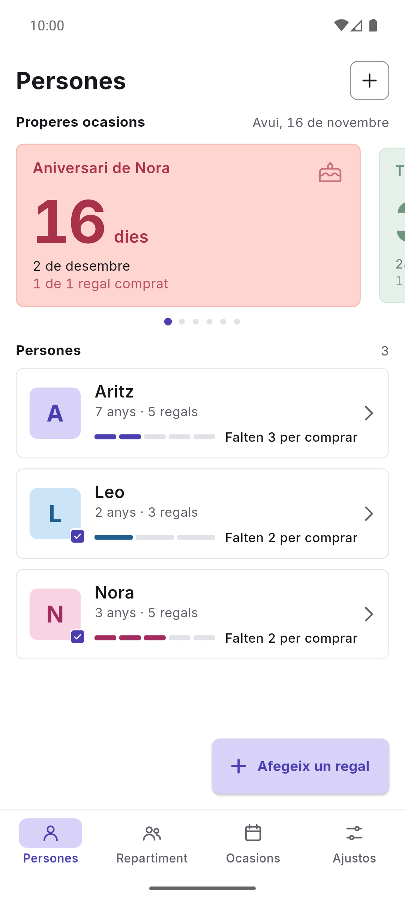
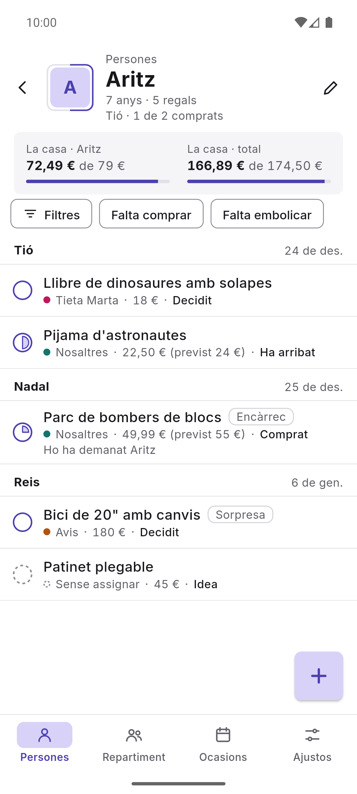
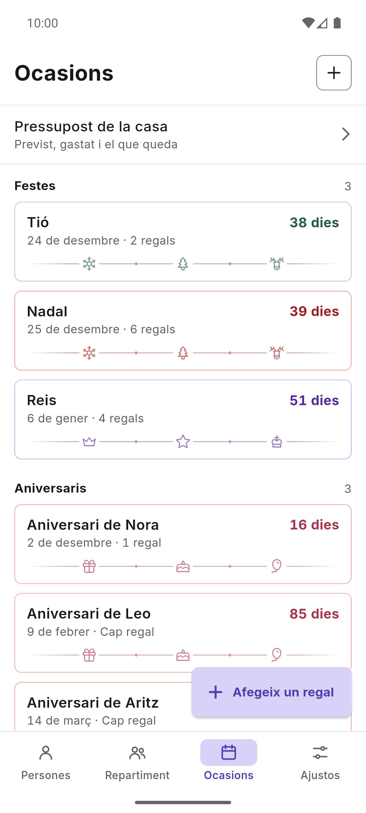
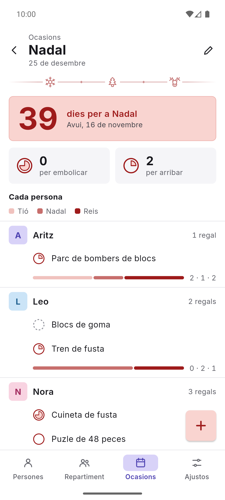
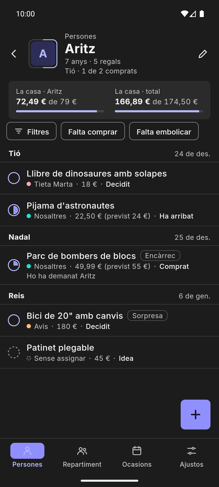

[English](README.md) · [Español](README.es.md) · **Català**

  

# Gift Huddle

Gift Huddle és la llibreta de regals de la família. Apunta què vol cada persona, qui l'hi regala i en quina ocasió, i mira d'un cop d'ull què falta per comprar o per embolicar. Està pensada per a les cases on Nadal, Reis i els aniversaris es reparteixen entre uns quants.

**Gratis · Sense anuncis · Sense compte · Sense connexió · Codi obert**

## Baixades

  
  
  <!--
  
  -->

Android 8 o posterior és en prova tancada a Google Play. La versió per a iPhone (iOS 16 o posterior) arribarà aviat a l'App Store. Més informació a [gifthuddle.app](https://gifthuddle.app).

Uneix-te a la beta de Google Play

1. Uneix-te al [grup de testers de Gift Huddle](https://groups.google.com/g/gifthuddle-tester) amb el compte de Google que fas servir al mòbil.
2. Obre la [pàgina de la prova](https://play.google.com/apps/testing/es.gifthuddle.app) amb aquest mateix compte i prem el botó per fer-te tester (en anglès, **Become a tester**).
3. Instal·la Gift Huddle des de Google Play i no surtis de la prova durant almenys 14 dies seguits: Google ho exigeix abans que l'app es pugui publicar per a tothom.

## Captures

  
  
  
  
  

Més captures

  

Prem una captura per ampliar-la.

## Funcions

- **El repartiment, d'un cop d'ull.** Una graella amb qui rep i qui regala: veus de seguida si a algú li falta un regal o si dues persones han pensat en el mateix.
- **Cada regal, amb el seu estat.** Idea, decidit, comprat, ha arribat, embolicat i lliurat. Filtra el que falta per comprar o per embolicar.
- **Ocasions amb compte enrere.** Tió, Nadal, Reis, aniversaris i les que hi afegeixis, amb els dies que queden i el que és pendent.
- **El pressupost de casa.** Previst, gastat i el que queda, per persona i en total.
- **Tots els mòbils, la mateixa llista.** Es manté al dia entre els mòbils de la família, xifrada d'extrem a extrem. Un mòbil nou hi entra amb un QR en persona.
- **Tancada per defecte.** PIN, empremta o rostre en obrir, i el contingut es tapa al selector d'apps.

Més funcions

- **Regals secrets.** Una sorpresa per a algú de la família queda oculta al mòbil d'aquesta persona.
- **Codi de recuperació.** Vint-i-quatre paraules et tornen la llista si perds el mòbil.
- **Versió web.** Obre la mateixa llista al navegador a web.gifthuddle.app després d'aparellar-lo una vegada.
- **Mòbils i tauletes.** Temes clar i fosc, en castellà, català i anglès.

## Privacitat

No hi ha comptes ni publicitat, i el desenvolupador no fa servir analítica ni informes d'errors. La teva llista es desa xifrada al teu mòbil. Per mantenir-la al dia entre els mòbils de la família, una còpia xifrada d'extrem a extrem viu en un servidor que no la pot llegir, i s'esborra quan ja no queda cap dispositiu amb accés. El lector de QR funciona sense connexió i sense serveis de Google.

[Política de privacitat](https://gifthuddle.app/ca/privacy/) · Suport: **gifthuddle@gifthuddle.app**.

## Novetats

La versió 1.0.3 (17 de novembre de 2026) obre un fitxer de recuperació directament des d'Arxius, també amb l'app ja oberta, i mostra «Desa en un fitxer» a la pantalla de les 24 paraules sense haver de baixar. La versió 1.0.2 (16 de novembre de 2026) permet desar el codi de recuperació en un fitxer, amb contrasenya si vols, fa que connectar la versió web torni a funcionar i vagi més de pressa, i evita que l'escàner QR es quedi en negre. La versió 1.0.0 (16 de novembre de 2026) és la primera a les botigues. Porta la llista de regals de cada persona, el repartiment en graella, les ocasions amb compte enrere, els regals secrets, compartir entre mòbils i amb la versió web, el codi de recuperació i els temes clar i fosc. Els detalls, a [CHANGELOG.md](CHANGELOG.md).

## Contribuir

Els avisos d'errors, les idees i les traduccions són benvinguts. Com compilar, provar i contribuir: [CONTRIBUTING.md](CONTRIBUTING.md). També pots escriure a **gifthuddle@gifthuddle.app**, i qui participi en la prova tancada pot fer servir les opinions de la fitxa de Google Play.

## Llicència

El codi es publica amb la [GNU General Public License v3.0](LICENSE). El nom, la icona i les captures de Gift Huddle no hi entren; els detalls, a [NOTICE.md](NOTICE.md). Inter es fa servir amb la llicència SIL Open Font License 1.1 i les icones de Tabler, amb la llicència MIT.
