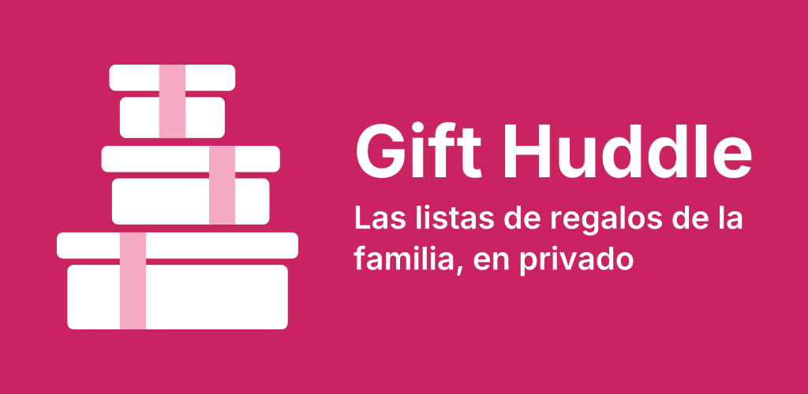
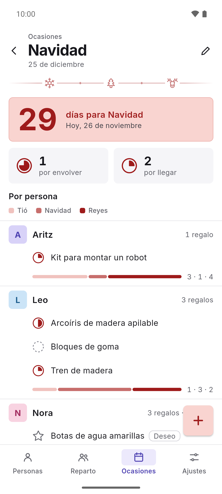
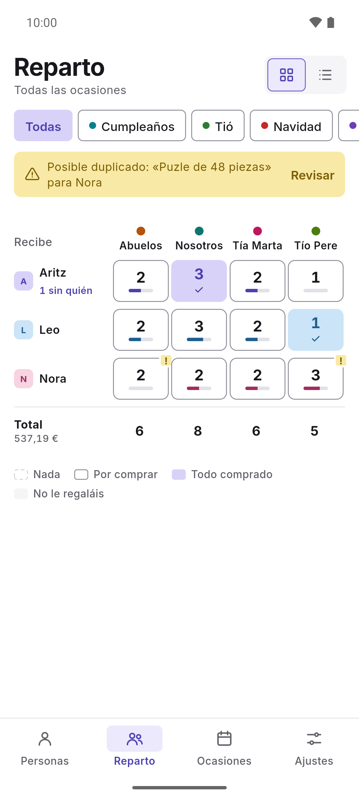
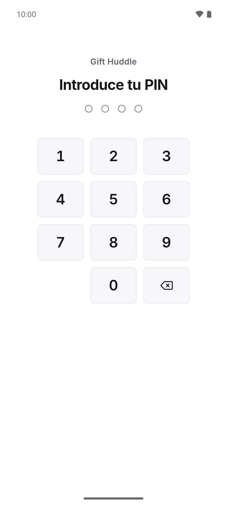
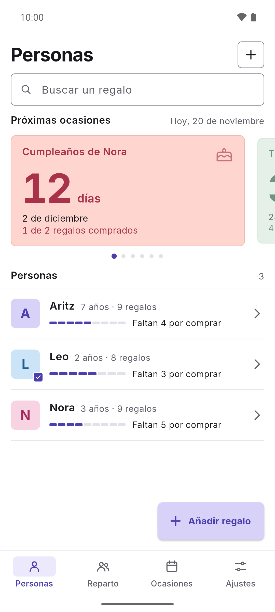
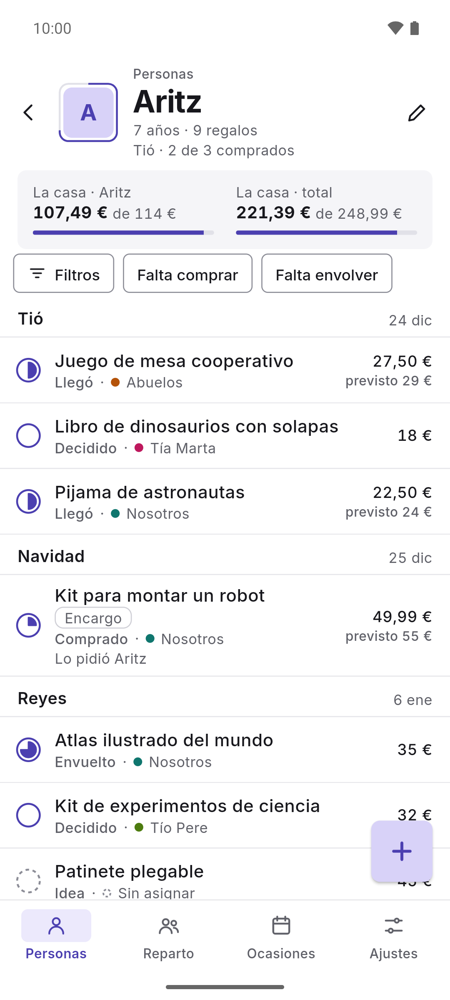
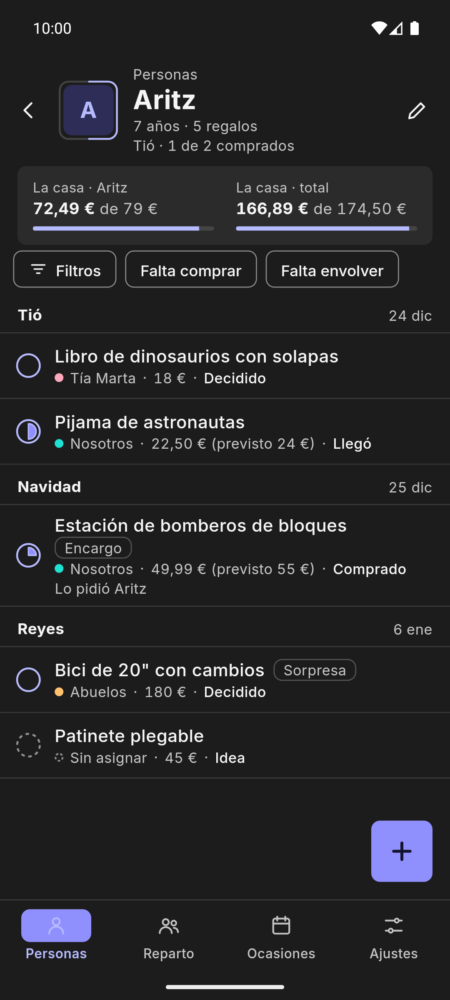

[English](README.md) · **Español** · [Català](README.ca.md)

  

# Gift Huddle

Gift Huddle es la libreta de regalos de la familia. Apunta qué quiere cada persona, quién se lo regala y en qué ocasión, y mira de un vistazo qué falta por comprar o por envolver. Está pensada para las casas donde Navidad, Reyes y los cumpleaños se reparten entre varios.

**Gratis · Sin anuncios · Sin cuenta · Funciona sin conexión · Código abierto**

## Descargas

  
  
  <!--
  
  -->

Android 8 o posterior está en prueba cerrada en Google Play. La versión para iPhone (iOS 16 o posterior) ya está en la App Store. Más información en [gifthuddle.app](https://gifthuddle.app).

Únete a la beta de Google Play

1. Únete al [grupo de testers de Gift Huddle](https://groups.google.com/g/gifthuddle-tester) con la cuenta de Google que usas en el móvil.
2. Abre la [página de la prueba](https://play.google.com/apps/testing/es.gifthuddle.app) con esa misma cuenta y pulsa el botón para hacerte tester (en inglés, **Become a tester**).
3. Instala Gift Huddle desde Google Play y no salgas de la prueba durante al menos 14 días seguidos: Google lo exige antes de que la app pueda publicarse para todo el mundo.

## Capturas

  
  
  
  
  

Más capturas

  

Pulsa una captura para ampliarla.

## Funciones

- **El reparto, de un vistazo.** Una rejilla con quién recibe y quién regala: ves al momento si a alguien le falta un regalo o si dos personas han pensado en el mismo.
- **Cada regalo, con su estado.** Idea, decidido, comprado, llegó, envuelto y entregado. Filtra lo que falta por comprar o por envolver.
- **Ocasiones con cuenta atrás.** Tió, Navidad, Reyes, cumpleaños y las que añadas, con los días que quedan y lo pendiente.
- **El presupuesto de la casa.** Previsto, gastado y lo que queda, por persona y en total.
- **Todos los móviles, la misma lista.** Se mantiene al día entre los móviles de la familia, cifrada de extremo a extremo. Un móvil nuevo entra con un QR en persona.
- **Cerrada por defecto.** PIN, huella o rostro al abrir, y el contenido se tapa en el selector de apps.

Más funciones

- **Regalos secretos.** Una sorpresa para alguien de la familia queda oculta en el móvil de esa persona.
- **Código de recuperación.** Veinticuatro palabras devuelven tu lista si pierdes el móvil.
- **Versión web.** Abre la misma lista en el navegador en web.gifthuddle.app tras emparejarlo una vez.
- **Móviles y tabletas.** Temas claro y oscuro, en castellano, catalán e inglés.

## Privacidad

No hay cuentas ni publicidad, y el desarrollador no usa analítica ni informes de errores. Tu lista se guarda cifrada en tu móvil. Para mantenerla al día entre los móviles de la familia, una copia cifrada de extremo a extremo vive en un servidor que no puede leerla, y se borra cuando ya no queda ningún dispositivo con acceso. El lector de QR funciona sin conexión y sin servicios de Google.

[Política de privacidad](https://gifthuddle.app/privacy/) · Soporte: **gifthuddle@gifthuddle.app**.

## Novedades

La versión 1.0.6 (22 de noviembre de 2026) hace que quien invita elija de quién es el móvil nuevo, oculta desde el primer momento los regalos de cada persona en su propio móvil, deja que la versión web vea y edite los regalos en secreto de los demás, admite hasta 200 regalos en secreto por persona y prueba otra ruta si el operador bloquea la conexión. La versión 1.0.5 (21 de noviembre de 2026) revisa todos los textos en castellano, catalán e inglés, pregunta antes de descartar los cambios de un regalo, pide el nombre del móvil al unirse con un enlace y arregla «Borrar todo» y los regalos en secreto. La versión 1.0.4 (20 de noviembre de 2026) trae un diseño más claro con nuevos tonos pastel en el modo oscuro, presupuesto por ocasión, las ocasiones más próximas primero, enlaces de regalo que se abren con un toque y cualquier persona de la familia como quien regala. La versión 1.0.3 (17 de noviembre de 2026) abre un fichero de recuperación directamente desde Archivos, también con la app ya abierta, y muestra «Guardar en un fichero» en la pantalla de las 24 palabras sin tener que bajar. La versión 1.0.2 (16 de noviembre de 2026) permite guardar el código de recuperación en un fichero, con contraseña si quieres, hace que conectar la versión web vuelva a funcionar y vaya más rápido, y evita que el escáner QR se quede en negro. La versión 1.0.0 (16 de noviembre de 2026) es la primera en las tiendas. Trae la lista de regalos de cada persona, el reparto en rejilla, las ocasiones con cuenta atrás, los regalos secretos, compartir entre móviles y con la versión web, el código de recuperación y los temas claro y oscuro. Los detalles, en [CHANGELOG.md](CHANGELOG.md).

## Contribuir

Se agradecen los avisos de fallos, las ideas y las traducciones. Cómo compilar, probar y contribuir: [CONTRIBUTING.es.md](CONTRIBUTING.es.md). También puedes escribir a **gifthuddle@gifthuddle.app**, y quien participe en la prueba cerrada puede usar las opiniones de la ficha de Google Play.

## Licencia

El código se publica con la [GNU General Public License v3.0](LICENSE). El nombre, el icono y las capturas de Gift Huddle no entran en ella; los detalles, en [NOTICE.md](NOTICE.md). Inter se usa con la licencia SIL Open Font License 1.1 y los iconos de Tabler, con la licencia MIT.
