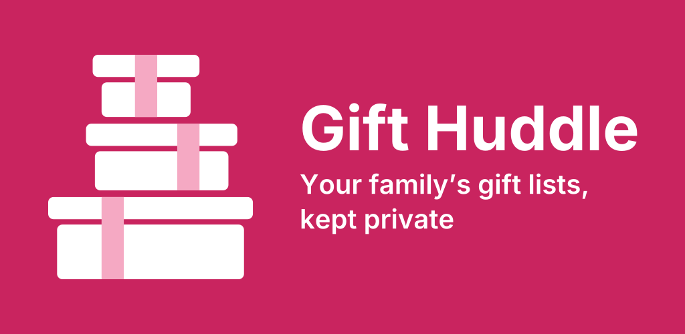
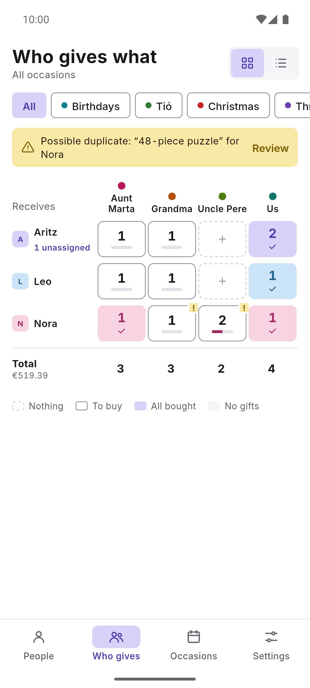
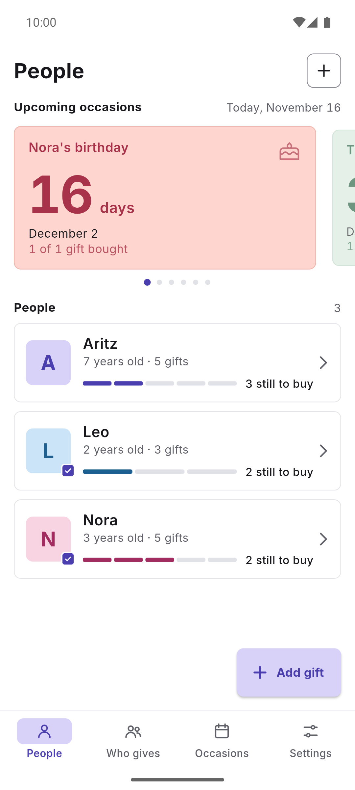
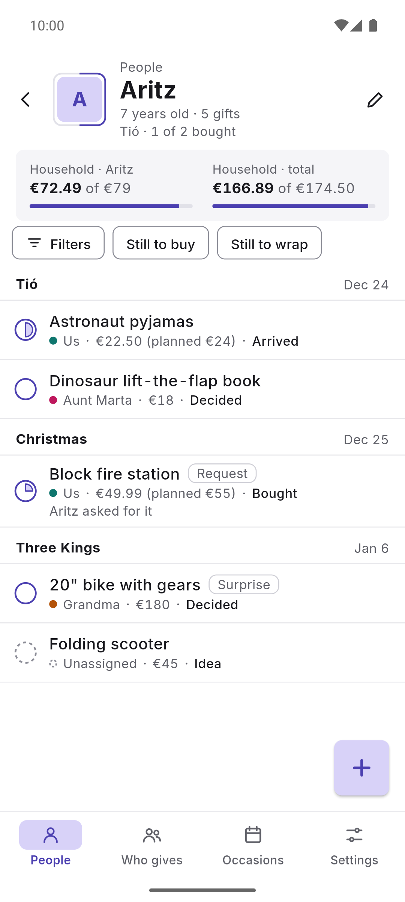
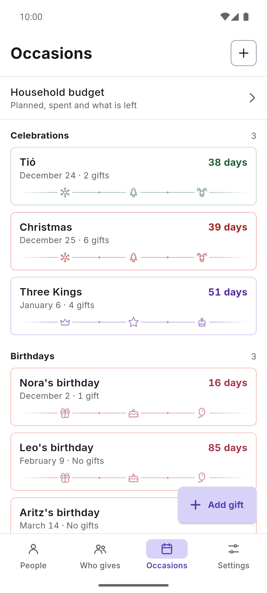
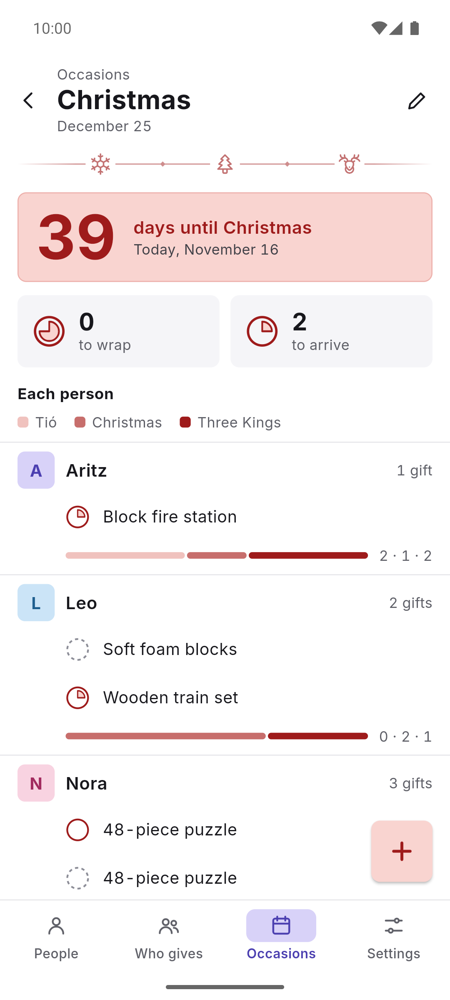

**English** · [Español](README.es.md) · [Català](README.ca.md)

  

# Gift Huddle

Gift Huddle is the family's gift notebook. Note what each person wants, who is giving it and for which occasion, and see at a glance what is still to buy or to wrap. It is made for homes where Christmas, Three Kings and birthdays are shared out among several people.

**Free · No ads · No account · Works offline · Open source**

## Download

  
  
  <!--
  
  -->

Android 8 or later is in closed testing on Google Play. The iPhone version (iOS 16 or later) is coming soon to the App Store. More about the app at [gifthuddle.app](https://gifthuddle.app).

Join the beta on Google Play

1. Open the [testing link](https://play.google.com/apps/testing/es.gifthuddle.app) with the Google account you use on your phone.
2. Choose to become a tester.
3. Install Gift Huddle from Google Play, as with any other app.

## Screenshots

  
  
  
  
  

More screenshots

  

Tap a screenshot to enlarge it.

## Features

- **Who gives what.** A grid of who receives and who gives, so you see at once if someone is missing a gift or two people had the same idea.
- **Every gift, with its status.** Idea, decided, bought, arrived, wrapped and given. Filter what is still to buy or to wrap.
- **Occasions with a countdown.** Tió, Christmas, Three Kings, birthdays and any you add, with the days left and what is pending.
- **The household budget.** Planned, spent and what is left, per person and in total.
- **Every phone, the same list.** It stays up to date across the family's phones, end-to-end encrypted. A new phone joins with a QR code in person.
- **Locked by default.** PIN, fingerprint or face when you open it, and the content is hidden in the app switcher.

More features

- **Secret gifts.** A surprise for someone in the family stays hidden on that person's phone.
- **Recovery code.** Twenty-four words bring your list back if you lose your phone.
- **Web version.** Open the same list in a browser at web.gifthuddle.app after pairing it once.
- **Phones and tablets.** Light and dark themes, in Spanish, Catalan and English.

## Privacy

There are no accounts or ads, and the developer uses no analytics or crash reporting. Your list is stored encrypted on your phone. To keep it up to date across the family's phones, an end-to-end encrypted copy lives on a server that cannot read it, and it is deleted once no device has access any more. The QR reader works offline and uses no Google services.

[Privacy policy](https://gifthuddle.app/en/privacy/) · Support: **gifthuddle@gifthuddle.app**.

## What's new

Version 1.0.0 (16 November 2026) is the first one in the stores. It brings the list of gifts for each person, the Who gives what grid, occasions with a countdown, secret gifts, sharing between phones and the web version, the recovery code, and light and dark themes. See [CHANGELOG.md](CHANGELOG.md) for the details.

## Contributing

Bug reports, ideas and translations are welcome. How to build, test and contribute: [CONTRIBUTING.md](CONTRIBUTING.md). You can also write to **gifthuddle@gifthuddle.app**, and testers in the closed test can use the feedback option on the Google Play page.

## License

The code is under the [GNU General Public License v3.0](LICENSE). The Gift Huddle name, icon and screenshots are not covered by it; see [NOTICE.md](NOTICE.md). Inter is used under the SIL Open Font License 1.1 and the Tabler icons under the MIT License.
